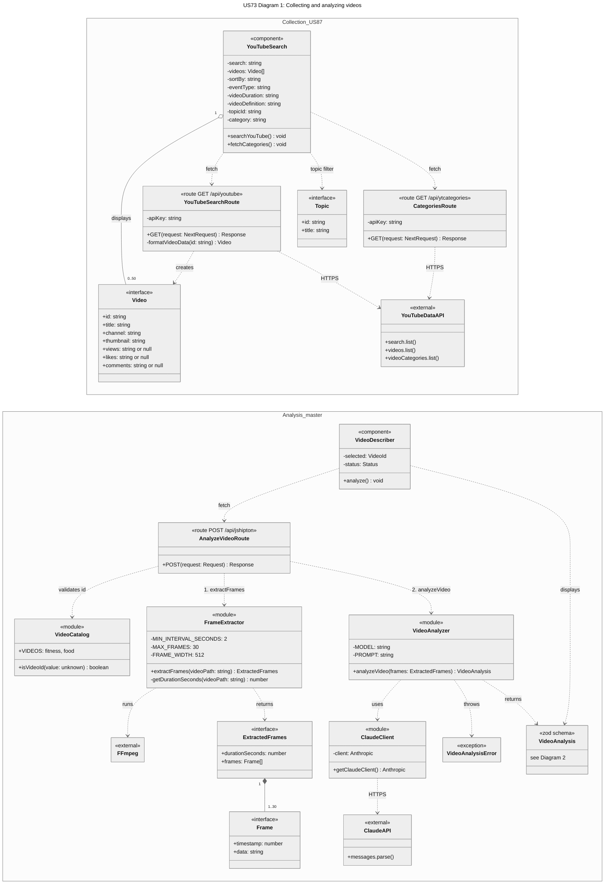
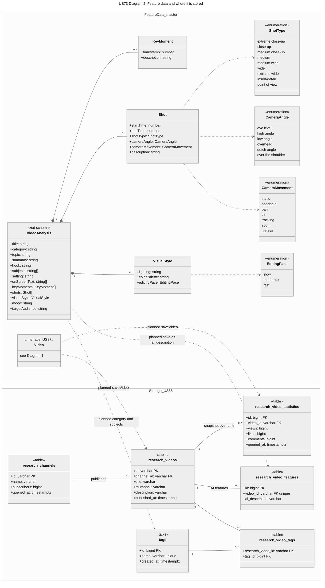

# US73: Feature Data Collection Class Diagram

These diagrams show how the reel-analyzer app collects videos, extracts their feature data with AI, and where that data will be stored. Class and field names match the code as of 11/05/2026 on `master` (video analysis), `US87-YT-Filters-UI` (YouTube search), and `US88-Make-Database-using-Supabase` (database schema).

## Diagram 1: Collecting and analyzing videos

The YouTube search collects candidate videos and their statistics. Video analysis extracts up to 30 frames with ffmpeg and sends them to Claude, which returns structured feature data.

## Diagram 2: Feature data and where it is stored

`VideoAnalysis` is the feature data Claude returns. The `research_*` tables from the US88 schema store collected videos, their statistics over time, their AI features, and tags. Dotted lines labeled "planned" are designed but not wired up yet: `saveVideo()` is commented out in the YouTube route, and nothing writes to `research_video_features` yet.

## How to read the diagrams

| Notation | Meaning |
| --- | --- |
| `<<component>>` | React component in the dashboard |
| `<<route ...>>` | Next.js API route, with its HTTP method and path |
| `<<module>>` | TypeScript module of functions and constants (not a class in the code) |
| `<<interface>>`, `<<zod schema>>` | Data shape passed between parts of the app |
| `<<table>>` | Supabase table from `src/lib/supabase/schema.sql` |
| `<<external>>` | Outside service or tool |
| `+` / `-` | Exported (public) / file-private |
| Dotted arrow | Uses, calls, or creates |
| Filled diamond | Composition: the part only exists inside the whole |
| Hollow diamond | Aggregation: the component holds a list of them |
| Plain line with numbers | Database relationship with its multiplicity |

Images of both diagrams are in this folder for viewers that don't display Mermaid.
